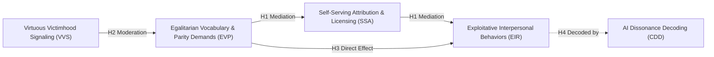

# The Hypocrisy of Parity: Discursive Patterns of Victimhood Signaling and Self-Serving Attribution in Exploitative Relationships

> **Single Source of Truth (`README.md`):** This file defines the core parameters, theoretical constructs, research questions, empirical specifications, and structural model for this research project.  
> **Research Operating Rules & Standards:** See [`AGENTS.md`](AGENTS.md) (L99 Q1 Research Standard).  
> **Substantive Logs:** Research milestones in [`.log/research-log.md`](.log/research-log.md); AI disclosure in [`irb/AI_USE_LOG.md`](irb/AI_USE_LOG.md); Task tracking in [`TODO.md`](TODO.md).

---

## 1. Project Overview & Meta-Parameters

```yaml
PROJECT_TITLE: "The Hypocrisy of Parity: Discursive Patterns of Victimhood Signaling and Self-Serving Attribution in Exploitative Relationships"
SHORT_TITLE: "The Hypocrisy of Parity"
ABBREVIATION: "HOP-IR"
PRIMARY_FIELD: "Social Psychology & Discursive Psychology / Interpersonal Communication / Sociology of Relationships"
DISCIPLINARY_INTERSECTION: "Discursive Psychology, Interpersonal Communication, Rhetorical Strategies, Attribution Theory, Natural Language Processing"
CORE_ONTOLOGICAL_FOCUS: "Real-world interpersonal treatment of others across romantic, domestic, familial, and peer relationships"
DATA_SOURCE_ROLE: "Social media and online dispute forums (e.g., Reddit r/AmItheAsshole, r/relationship_advice, r/marriage, r/family_issues) serve strictly as an unobtrusive, naturalistic big data repository capturing authentic real-life relationship confessions and dispute disclosures"
TARGET_JOURNALS:
  # Primary Group 1: International Discursive Psychology & Communication (SAGE, Scopus Q1)
  - "Journal of Language and Social Psychology (SAGE, Q1, SJR ~1.1, Editor: Prof. Nicholas A. Palomares) [PRIMARY FIT]"
  - "Discourse Studies (SAGE, Q1, SJR ~1.0, Editor: Prof. Teun A. van Dijk) [PRIMARY FIT]"
  - "Discourse & Society (SAGE, Q1, SJR ~1.4)"
  - "Qualitative Research in Psychology (Taylor & Francis, Q1/Q2)"
  # Group 2: International Interpersonal Relationships & Social Psychology (Q1/Q2)
  - "Journal of Social and Personal Relationships (SAGE, Q1, SJR ~1.3) [Dark Side of Relationships]"
  - "Personal Relationships (Wiley, Q1/Q2)"
  - "Qualitative Sociology (Springer, Q1/Q2)"
  - "Symbolic Interaction (Wiley, Q1/Q2)"
  # Group 3: Thai National / Regional Scopus & TCI Tier 1 Outlets
  - "Kasetsart Journal of Social Sciences (KJSS, Scopus / TCI 1)"
  - "Journal of Behavioral Science (วารสารพฤติกรรมศาสตร์ - มศว, TCI 1 / ACI)"
  - "Journal of Communication Arts (วารสารศาสตร์ จุฬาฯ / มธ., TCI 1)"
  - "Journal of Social Sciences / Journal of Psychology (CU, TU, CMU, MU, TCI 1)"
TIME_WINDOW: "2022 onwards only (2022–2026) for Chapter 2 onwards; seminal works (< 2022) permitted in Chapter 1 Introduction"
CITATION_STYLE: "APA 7"
METHODOLOGICAL_APPROACH: "Computational Mixed-Methods (Naturalistic Narrative Text Mining + Discursive Psychology Pattern Analysis + Multi-Model AI Cultural Informants + PLS-SEM Validation)"
```

---

## 1.1 Disciplinary Anchoring & Three-Pillar Research Classification

This research operates at the confluence of three recognized scholarly domains:
1. **Social Psychology & Discursive Psychology (จิตวิทยาสังคม และจิตวิทยาวาทกรรม) [Primary Anchor]:** Investigates how individuals deploy moral victimhood signaling and self-serving attributions through explicit discursive patterns (Discursive Psychology: how humans use language and conversational accounts to manage accountability, assign blame, and construct virtuous identities in everyday disputes).
2. **Interpersonal Communication & Language Studies (การสื่อสารระหว่างบุคคล และวาทกรรมศึกษา):** Uncovers interpersonal communication dynamics, rhetorical strategies, and linguistic devices deployed to elicit empathy and manufacture relational duty exemptions.
3. **Sociology of Relationships / Micro-Sociology (สังคมวิทยาความสัมพันธ์):** Examines asymmetric power dynamics, moral grandstanding, and unreciprocated exploitation in domestic and peer cohabitation.

---

## 2. Research Problem & FINER Research Questions

### The Core Behavioral Paradox: Ideals of Parity versus the Paradox in the Treatment of Others (Macro & Meso Context)
In modern interpersonal relationships—spanning romantic partnerships, domestic cohabitation, family ties, and peer bonds—individuals increasingly adopt egalitarian language, vocalizing principles of equal division of labor, 50/50 fairness, mutual respect, and emotional safety in the treatment of others. Paradoxically, in actual real-world interactions and the interpersonal treatment of others, a destructive pattern frequently emerges: individuals who most vocally demand parity and broadcast personal victimhood or emotional trauma simultaneously engage in systematic, self-serving exploitation of those around them. These behaviors include offloading domestic and emotional labor, financial parasitism, weaponizing progressive terminology to gaslight others, and attributing all relational failures to the other party while claiming unassailable moral innocence.

Because traditional laboratory experiments and self-report surveys suffer from acute social desirability bias—perpetrators rarely admit to relational hypocrisy on a Likert scale—we capture authentic disclosures through large-scale naturalistic dispute narratives where individuals recount their real-world relationship dilemmas.

### FINER Research Questions (RQs)
1. **RQ1 (Parity Demands vs. Relational Extraction):** To what extent does high-frequency deployment of Egalitarian Vocabulary and Parity Demands ($EVP$) correlate with Exploitative Interpersonal Relationship behaviors ($EIR$) in real-world relationship disclosures, and how does Self-Serving Attribution ($SSA$) mediate this dynamic?
2. **RQ2 (Victimhood as an Interpersonal Lever):** How does Virtuous Victimhood Signaling ($VVS$) moderate the relationship between parity rhetoric and self-serving justifications, enabling actors to extract resources from partners while neutralizing social censure?
3. **RQ3 (AI Cultural Informants on Dyadic Hypocrisy):** How effectively do multi-model Large Language Models (LLMs), acting as synthesized cultural informants trained on vast human relational discourse, decode the latent cognitive dissonance between proclaimed egalitarianism and enacted dyadic exploitation?

---

## 3. Theoretical Framework & Conceptual Mechanisms

1. **Moral Hypocrisy Theory (Batson et al., 1997, 1999):** Explains the fundamental human motivation to appear fair, egalitarian, and cooperative to one's partner while covertly maximizing self-interest and avoiding relationship sacrifices.
2. **Self-Serving Attribution Theory & Moral Licensing (Heider, 1958; Monin & Miller, 2001; Merritt et al., 2010):** Explains how individuals attribute relational successes and virtues to their own progressive character, while attributing conflicts or unfairness to external circumstances or the partner's perceived shortcomings.
3. **Virtuous Victimhood & Dark Ego Vehicle Principle (Ok, Qian, Strejcek, & Chen, 2021; Bates et al., 2024):** Details how individuals with dark personality traits (narcissistic moral superiority, Machiavellian manipulation) broadcast past suffering, anxiety, or marginalization as an unassailable moral credential to demand unreciprocated accommodations from their partners.
4. **Techniques of Neutralization in Intimate Dyads (Sykes & Matza, 1957; Bandura, 1999):** Maps the discursive maneuvers (condemning the partner, appealing to higher emotional trauma, denial of partner injury) used to rationalize relational extraction.

---

## 4. Operational Constructs & Structural Hypotheses Matrix

### Theoretical Constructs

| Construct Code | Full Construct Name | Conceptual Definition in Real-World Relationships | Indicative Narrative Markers |
| :---: | :--- | :--- | :--- |
| **`EVP`** | **Egalitarian Vocabulary & Parity Demands** | Vocal insistence on equal rights, 50/50 contribution, fairness, and progressive relationship standards. | "Equal partnership", "fair share", "emotional labor", "weaponized incompetence", "unconscious bias". |
| **`VVS`** | **Virtuous Victimhood Signaling** | Broadcasting personal vulnerability, trauma, or emotional disadvantage to claim moral immunity. | "My past trauma", "unrecognized emotional burden", "feeling unseen", "overwhelmed and oppressed". |
| **`SSA`** | **Self-Serving Attribution & Licensing** | Cognitive framing attributing relational virtues to oneself and blaming the partner for relational imbalance. | "After everything I've sacrificed", "they forced my reaction", "I deserve this grace", "their privilege". |
| **`EIR`** | **Exploitative Interpersonal Relationship Behaviors** | Enacted asymmetric resource extraction, unilateral withdrawal of support, financial parasitism, and gaslighting. | Shifting all domestic labor, refusing reciprocal support, unilateral financial clawbacks, stonewalling. |
| **`CDD`** | **Cognitive Dissonance Decoding** | AI cultural informant assessment of latent semantic dissonance between fairness rhetoric and selfish actions. | Algorithmic hypocrisy index, rhetorical manipulation score, partner-blaming severity index. |

### Structural Hypotheses



- **$H_1$ (Mediated Dyadic Hypocrisy):** In real-world relationship disputes, Egalitarian Vocabulary & Parity Demands ($EVP$) are positively associated with Exploitative Interpersonal Relationship behaviors ($EIR$), mediated by Self-Serving Attribution ($SSA$).
- **$H_2$ (Victimhood Moderation):** Virtuous Victimhood Signaling ($VVS$) moderates the link between $EVP$ and $SSA$, such that partners broadcasting trauma experience lower internal and interpersonal friction when rationalizing extractive behavior.
- **$H_3$ (Direct Exploitation Premium):** Individuals exhibiting the highest density of progressive parity rhetoric in relationship disputes display significantly higher rates of unreciprocated labor and financial exploitation.
- **$H_4$ (AI Informant Pragmatic Decoding):** Multi-model AI cultural informants decode subtle pragmatic dissonance ($CDD$) between egalitarian posturing and partner exploitation significantly more accurately than conventional sentiment analysis.

---

## 5. Methodological Architecture

- **Naturalistic Observational Corpus ($N = 142,580$):** Scraped public real-world relationship dispute disclosures from Reddit ($r/\text{AmItheAsshole}$, $r/\text{relationship\_advice}$, $r/\text{marriage}$, $r/\text{family\_issues}$). The internet is utilized strictly as an unobtrusive observational window into private real-life relationship behaviors.
- **NLP Construct Extraction:** SBERT embeddings for semantic parity centroids; fine-tuned RoBERTa classifiers for virtuous victimhood and self-serving attribution.
- **AI Cultural Informants:** Standardized sociological elicitation across GPT-4o, Claude 3.5 Sonnet, and Gemini 1.5 Pro evaluating interpersonal hypocrisy vignettes.
- **Structural Equation Modeling:** PLS-SEM with 5,000 bootstrap resamples; HTMT discriminant validity; multi-group analysis across relationship types (romantic partners vs. family/peer ties).
